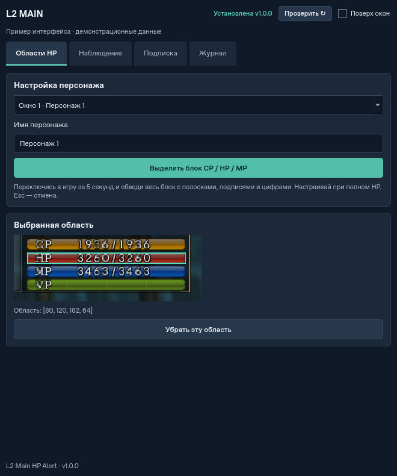
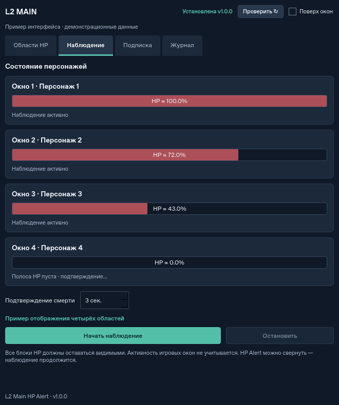

# Как пользоваться L2 Main HP Alert

## 1. Скачать и запустить

1. Открой [последний релиз](https://github.com/Teatimo/L2-Main-HP-Alert-Updates/releases/latest).
2. В Assets скачай полный архив **`L2_Main_HP_Alert_1.0.0_Windows.zip`**. Для будущих версий выбирай файл с окончанием `_Windows.zip`.
3. Распакуй весь архив в обычную папку. Не запускай программу изнутри ZIP.
4. Открой **`L2MainHPAlert.exe`**. Папки `app` и `runtime` оставь рядом с ним.

Нужна Windows 10/11 x64. Python уже включён в сборку.

## 2. Проверить подписку

Открой вкладку **«Подписка»**. Если калькулятор активирован на этом ПК, ключ подставится автоматически. Иначе введи свой действующий ключ и нажми «Обновить статус подписки».

Для нового ключа сначала выполни обычную активацию в L2 Essence Calculator. HP Alert использует ту же подписку, её срок и привязку к компьютеру.

## 3. Подключить Telegram

Если отображается, что Telegram уже привязан, переходи к тестовому уведомлению.

Если привязки нет:

1. Нажми **«Получить код привязки»**. Код скопируется в буфер обмена.
2. Открой Mini App калькулятора через [бота L2 Essence Calculator](https://t.me/L2EssenceCalcBot).
3. Вставь код в существующее поле привязки лицензии.
4. Вернись в HP Alert и нажми **«Обновить статус подписки»**.

Затем нажми **«Открыть бота»** в HP Alert и **Start / Запустить** в Telegram. В программе нажми **«Проверить уведомление»** и дождись сообщения.

Создавать личного бота, вводить токен или Chat ID не нужно.

## 4. Настроить области HP

1. Расположи игровые окна так, чтобы блоки HP оставались видимыми.
2. Дождись полного здоровья персонажа.
3. Открой **«Области HP»**, выбери «Окно 1» и укажи имя персонажа.
4. Нажми **«Выделить блок CP / HP / MP»**.
5. За пять секунд переключись в игру. На затемнённом снимке обведи весь блок с подписями, полосками и цифрами, затем отпусти левую кнопку мыши. Esc отменяет выделение.
6. Проверь образец: найденная красная HP отмечена рамкой.
7. Повтори для областей 2–4, если они нужны.

Настраивать все четыре области необязательно. Убрать лишнюю можно кнопкой **«Убрать эту область»**.

*Пример интерфейса с демонстрационными данными.*

## 5. Включить наблюдение

Открой вкладку **«Наблюдение»**, выбери время подтверждения смерти и нажми **«Начать наблюдение»**.

После включения каждая область сначала должна показывать HP выше 10% не менее двух секунд. Пустая полоса подтверждается заданное время — по умолчанию три секунды. После уведомления новое событие разрешается после восстановления HP выше 10% в течение пяти секунд.

Все четыре области работают независимо. В Telegram будут указаны имя персонажа и номер области.

*Пример отображения разных состояний, а не снимок живого наблюдения.*

Игровым окнам не нужно быть активными. HP Alert можно свернуть. Выбранные игровые блоки HP должны оставаться на экране; после их перемещения или изменения масштаба выдели области заново.

## 6. Обновления

Программа проверяет GitHub при запуске и раз в четыре часа. Кнопка **«Проверить ↻»** запускает проверку вручную.

Если найдена новая версия, установи её через кнопку обновления. Перед перезапуском сохраняются настройки. После запуска новой версии наблюдение нужно включить снова.

При ручном переходе с предварительной сборки закрой старую программу и распакуй полную новую сборку в отдельную папку. Настройки и лицензия читаются из прежних пользовательских файлов.

## Частые вопросы

### Почему не пришло сообщение?

Сначала проверь тестовую отправку. Посмотри вкладку «Журнал», статус подписки и привязку Telegram. Убедись, что в общем боте нажата кнопка Start и он не заблокирован.

При нестабильном интернете запрос может дойти до сервера, а подтверждение — потеряться. Неопределённо доставленные события не повторяются автоматически. На сервере действует ограничение шесть попыток уведомлений за минуту на подписку, включая тестовые отправки.

### Почему область в паузе?

Программа может не видеть неподвижную подпись HP, если блок перемещён, скрыт или перекрыт. Проверь выбранную область и при необходимости выдели её заново. Ошибка одной области не останавливает остальные.

### HP почти ноль, но персонаж ещё жив. Возможна ошибка?

Да. Программа оценивает изображение полосы, а не читает числовое HP из игры. При крайне низком здоровье полоса может выглядеть пустой. На распознавание также влияют эффекты, прозрачность, фильтры и масштаб интерфейса.

### Нужен ли VPN?

ПК должен иметь доступ к серверу лицензий и уведомлений. Если он доступен напрямую, VPN для этого подключения не требуется. На устройстве, где ты читаешь сообщения, Telegram также должен иметь рабочее соединение. Доступность зависит от сети пользователя.

### Нужен ли открытый Telegram на игровом ПК?

Нет. Сообщение отправляет сервер. Важно, чтобы Telegram имел подключение на устройстве, где ты получаешь уведомления.

### Где хранятся настройки?

Области и имена сохраняются на ПК в `%LOCALAPPDATA%\L2MainHPAlert`. Лицензия используется из существующих пользовательских файлов калькулятора. Полные снимки рабочего стола и изображения HP не отправляются на сервер.

### Как сообщить об ошибке?

Создай [обращение в Issues](https://github.com/Teatimo/L2-Main-HP-Alert-Updates/issues/new?template=bug_report.yml). Укажи версию программы, Windows, описание действий и текст ошибки. Скриншот выбранного блока HP можно приложить без лишних личных данных. Ключи лицензий и токены прикладывать не нужно.

[Вернуться на главную страницу](README.md)
