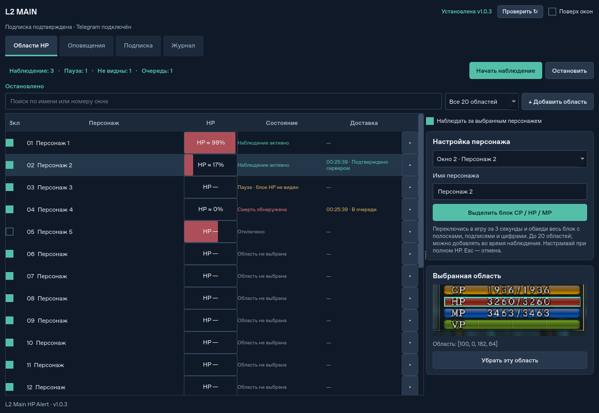
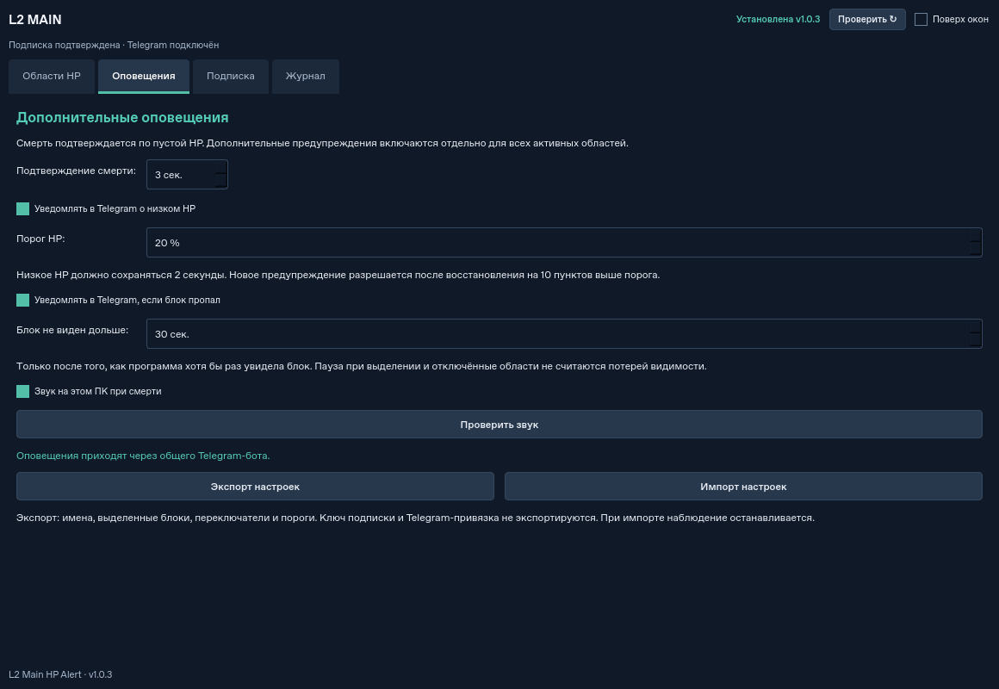

# L2 Main HP Alert

**Уведомления о смерти и низком HP персонажей Lineage 2 Main в Telegram**

До 20 видимых областей HP · Windows · Общая подписка с L2 Essence Calculator

### [Скачать для Windows](https://github.com/Teatimo/L2-Main-HP-Alert-Updates/releases/latest)

[Приобрести подписку](https://funpay.com/users/11571233/) · [Как пользоваться](INSTALL_RU.md) · [Что нового](CHANGELOG.md) · [Поддержка](https://github.com/Teatimo/L2-Main-HP-Alert-Updates/issues/new)

---

## Следи за персонажами, даже когда отошёл от компьютера

L2 Main HP Alert проверяет полосы здоровья на экране и отправляет сообщения в Telegram. В уведомлении указаны **имя персонажа и номер области** — сразу понятно, какое окно проверить.

Подключи от одного до **20 видимых блоков HP**. Игровым окнам не нужно быть активными: главное, чтобы выбранные блоки оставались видимыми на экране. Саму HP Alert можно свернуть.

Помимо смерти, можно включить предупреждение о **низком HP** и о том, что **блок здоровья долго не виден**. Дополнительные оповещения настраиваются отдельно и изначально выключены.

## Новый интерфейс

Все персонажи собраны в компактной таблице: переключатель наблюдения, имя, HP, состояние и доставка последнего сообщения. Справа — настройка выбранной области. Сверху — запуск, остановка и сводка состояний.

*Интерфейс v1.0.3 с демонстрационными именами, значениями HP и состояниями доставки. Нажми на изображение, чтобы открыть его полностью.*

## Возможности

| Функция | Как это помогает |
| --- | --- |
| **До 20 областей HP** | Независимое наблюдение за несколькими персонажами в одной программе. |
| **Индивидуальные переключатели** | Временно отключай одного персонажа, сохраняя имя и выделение. Остальные продолжают работу. |
| **Настройка без общей остановки** | Добавляй и меняй области во время наблюдения. После выделения или отмены работа продолжается автоматически. |
| **Выделение мышью** | Выбирай весь блок CP / HP / MP с цифрами, подписями и рамкой в любом месте экрана. |
| **Компактная таблица** | HP, текстовое состояние и доставка видны в одной строке. Цвет помогает быстро найти проблему. |
| **Поиск и фильтры** | Найди персонажа по имени или номеру; покажи настроенные, включённые или требующие внимания области. |
| **Общая сводка** | Видно, сколько областей наблюдается, на паузе, не видно и сколько сообщений ожидает отправки. |
| **Смерть персонажа** | Уведомление после подтверждённой пустой полосы, с защитой от повторов до восстановления здоровья. |
| **Низкий HP** | Необязательное предупреждение с настраиваемым порогом и подтверждением в течение двух секунд. |
| **Потеря видимости** | Необязательное сообщение, если ранее видимый блок долго остаётся скрытым. |
| **Локальный звук** | Системный сигнал Windows при смерти, с отдельной кнопкой проверки. |
| **Состояния доставки** | Очередь, отправка, подтверждение сервером или ошибка — с временем и подробностями в журнале. |
| **Приоритет смерти** | Сообщения о смерти идут раньше ожидающих дополнительных предупреждений. |
| **Экспорт и импорт** | Переноси области, имена и параметры оповещений через JSON. Лицензия и Telegram-привязка в экспорт не входят. |
| **Общий Telegram-бот** | Не нужно создавать собственного бота, вводить токен или Chat ID. |
| **Общая подписка** | Используется действующий ключ L2 Essence Calculator на том же ПК. |
| **Автообновления** | Проверка новых версий и установка с проверкой подписи Ed25519 и SHA-256. |

## Оповещения под твой способ игры

*Пример вкладки «Оповещения». Дополнительные опции включены для демонстрации; при первом запуске они выключены.*

### Смерть персонажа

После запуска область сначала должна показать HP выше 10% в течение двух секунд. Затем пустая полоса подтверждается выбранное время — **по умолчанию три секунды**. Одно уведомление отправляется на одно событие; повтор разрешается после восстановления HP выше 10% в течение пяти секунд.

### Низкий HP

Выбери порог от **5 до 90%**. Предупреждение отправляется, если положительный HP не выше порога держится не менее двух секунд. Для следующего предупреждения здоровье должно восстановиться минимум на **10 процентных пунктов выше порога**.

При нулевой HP работает отдельное подтверждение смерти: предупреждение низкого HP для нулевого значения не создаётся.

### Блок HP не виден

Выбери задержку от **5 до 600 секунд** — по умолчанию 30. Сообщение отправится, если программа уже видела блок, а затем потеряла его на заданное время. Для следующего предупреждения блок должен снова быть виден не менее двух секунд.

Отключённые области, общая остановка и пауза при выделении не накапливают время подтверждения оповещений.

## Быстрый старт

1. Открой [последний релиз](https://github.com/Teatimo/L2-Main-HP-Alert-Updates/releases/latest) и в **Assets** скачай полный архив с окончанием **`_Windows.zip`**.
2. Распакуй **весь архив** и запусти **`L2MainHPAlert.exe`**. Папки `app` и `runtime` оставь рядом с ним; устанавливать Python не требуется.
3. Открой **«Подписка»**, проверь действующий ключ калькулятора и привязку Telegram. Если калькулятор активирован на этом ПК, ключ подставится автоматически.
4. Нажми **«Открыть бота»**, затем **Start / Запустить** в Telegram. Проверь тестовое уведомление из программы.
5. В **«Области HP»** выбери строку, укажи имя и при полном здоровье нажми **«Выделить блок CP / HP / MP»**. Через три секунды обведи весь блок.
6. Настрой остальные нужные области и нажми **«Начать наблюдение»**. Необязательно заполнять все 20 строк.

Подробная привязка подписки, настройка оповещений и ответы на вопросы — в [руководстве](INSTALL_RU.md).

## Управление без потери настроек

**Переключатель в строке** временно отключает только выбранного персонажа. Координаты и имя сохраняются. Кнопка **«Убрать эту область»** удаляет выделение — используй её, когда область больше не нужна.

Для добавления нажми **«+ Добавить область»** или выбери свободный номер справа. На время выделения распознавание кратко приостанавливается, чтобы затемняющая рамка не вызвала ложное событие. После выбора или **Esc** наблюдение продолжается автоматически.

Кнопки **«Экспорт настроек»** и **«Импорт настроек»** находятся во вкладке **«Оповещения»**. При импорте требуется подтверждение замены, а наблюдение останавливается. После переноса на другой экран проверь расположение блоков.

## Доставка в Telegram

В таблице отображаются время и состояние последнего уведомления: **«В очереди» → «Отправляется» → «Подтверждено сервером»**. Если подтверждения нет, причина доступна в журнале и подсказке строки.

Подтверждение сервером означает успешный ответ Telegram на отправку, **а не прочтение сообщения**. Сообщения отправляются последовательно. При неопределённом результате автоматический повтор не выполняется, чтобы не создавать дубли. Очередь хранится, пока программа запущена.

## Подписка и обновления

HP Alert использует **общую подписку L2 Essence Calculator**, её срок и привязку к тому же компьютеру. Для нового ключа сначала выполни обычную активацию в калькуляторе. Если Telegram уже привязан к лицензии, повторять привязку не требуется.

Подписка проверяется в фоне, в том числе при остановленном наблюдении. При временной потере связи проверка повторяется автоматически.

Обновления проверяются при запуске, затем раз в четыре часа и кнопкой **«Проверить ↻»**. Перед установкой проверяются подпись и контрольная сумма. Настройки и лицензия сохраняются; после перезапуска наблюдение нужно включить снова.

| Файл в Assets | Назначение |
| --- | --- |
| `L2_Main_HP_Alert_1.0.3_Windows.zip` | **Полная программа для первой установки. Скачивай этот файл.** |
| `L2MainHPAlert-app-v1.0.3.zip` | Файлы для встроенного обновления; для первого запуска не подходят. |
| `hp-update.json` и `hp-update.sig` | Служебные файлы проверки обновления. |

В следующих выпусках номер версии в именах архивов меняется.

## Требования и помощь

Нужны **Windows 10/11 x64**, интернет, действующая общая подписка и видимые блоки HP.

**Свёрнутые и перекрытые игровые блоки не отслеживаются.** После перемещения HP, изменения размера окна или масштаба интерфейса выдели область заново. Определяется визуальное заполнение полосы, а не точное числовое здоровье из игры; эффекты, прозрачность и очень низкий HP могут влиять на распознавание.

Программа не читает память игры, не внедряется в её процесс и не управляет персонажем. Изображения выбранных областей не отправляются на сервер.

Для связи нужен доступ ПК к серверу, а Telegram на устройстве получения должен иметь подключение. VPN для подключения программы не требуется, если сервер доступен через твою сеть напрямую.

По вопросам подписки обращайся в чат заказа. Об ошибке можно сообщить через [Issues](https://github.com/Teatimo/L2-Main-HP-Alert-Updates/issues/new): укажи версию, Windows и последовательность действий. Ключи лицензий и токены к обращению не прикладывай.

Связанный проект: [L2 Essence Calculator](https://github.com/Teatimo/L2-Essence-Calculator-Updates).
