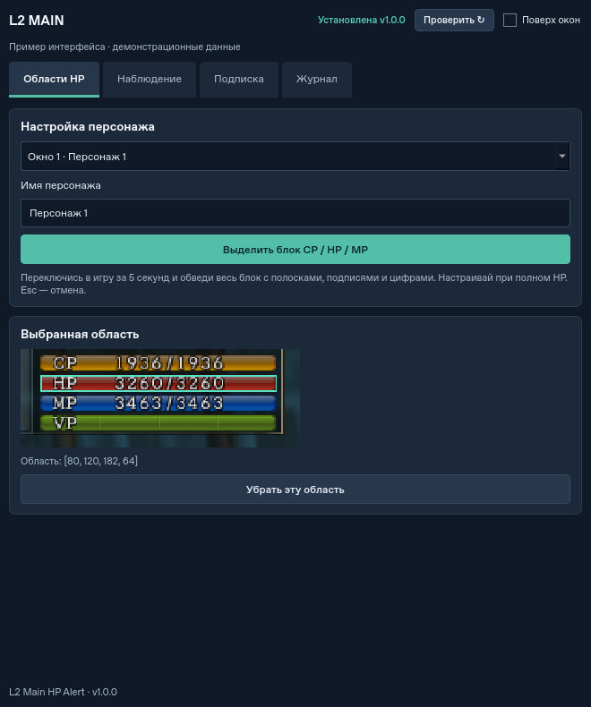

# L2 Main HP Alert

**Уведомления о смерти персонажей Lineage 2 Main в Telegram**

До четырёх видимых областей HP · Windows · Общая подписка с L2 Essence Calculator

### [Скачать для Windows](https://github.com/Teatimo/L2-Main-HP-Alert-Updates/releases/latest)

[Как пользоваться](INSTALL_RU.md) · [Что нового](CHANGELOG.md) · [Сообщить об ошибке](https://github.com/Teatimo/L2-Main-HP-Alert-Updates/issues/new?template=bug_report.yml)

---

## Узнай о смерти персонажа, даже когда отошёл от компьютера

L2 Main HP Alert следит за полосами здоровья на экране и отправляет сообщение в Telegram, когда обнаруживает пустую HP. В уведомлении указаны имя персонажа и номер области — сразу понятно, какое окно проверить.

Можно наблюдать за одним персонажем или расположить рядом до четырёх игровых окон. **Активность окон не учитывается: важно, чтобы выбранные блоки HP оставались видимыми.**

## Возможности

| Функция | Как это помогает |
| --- | --- |
| **До четырёх областей HP** | Независимое наблюдение за несколькими персонажами в одной программе. |
| **Выделение мышью** | Блок CP / HP / MP можно выбрать в любом месте экрана, вместе с цифрами и рамкой. |
| **Уведомления в Telegram** | Сообщения приходят через общего бота. Создавать своего бота и вводить его токен не нужно. |
| **Имена персонажей** | В сообщении отображаются имя и номер области. |
| **Подтверждение смерти** | Пустая полоса должна сохраняться заданное время; задержка настраивается. |
| **Защита от повторов** | Одно уведомление на смерть; новое событие разрешается после восстановления HP. |
| **Сохранение настроек** | Имена и выбранные области сохраняются между запусками. |
| **Общая подписка** | Используется действующий ключ L2 Essence Calculator на том же ПК. |
| **Автообновления** | Проверка новых версий при запуске, по расписанию и вручную; проверка подписи и SHA-256 перед установкой. |

## Интерфейс

| Области HP | Наблюдение |
| --- | --- |
|  |  |

*Примеры интерфейса с демонстрационными именами и значениями HP. Нажми на изображение, чтобы открыть его в полном размере.*

Вкладки расположены в порядке работы: **Области HP → Наблюдение → Подписка → Журнал**. Вверху показаны установленная версия, кнопка проверки обновлений и переключатель «Поверх окон».

## Быстрый старт

1. Открой [последний релиз](https://github.com/Teatimo/L2-Main-HP-Alert-Updates/releases/latest) и скачай **`L2_Main_HP_Alert_1.0.0_Windows.zip`**. В последующих выпусках выбирай полный архив с окончанием `_Windows.zip`.
2. Распакуй **весь архив** и запусти **`L2MainHPAlert.exe`**. Папки `app` и `runtime` должны оставаться рядом с EXE. Устанавливать Python не требуется.
3. На вкладке «Подписка» проверь действующий ключ калькулятора и привязку Telegram. Если калькулятор уже активирован на этом ПК, ключ подставится автоматически.
4. Открой общего бота кнопкой в программе и нажми **Start / Запустить**. Выполни тестовую отправку уведомления.
5. При полном здоровье выдели блок CP / HP / MP для каждого нужного персонажа, укажи имена и нажми **«Начать наблюдение»**.

Подробная настройка и ответы на частые вопросы — в [руководстве](INSTALL_RU.md).

## Как работает наблюдение

Программа анализирует изображение выбранных областей рабочего стола. Красная полоса находится внутри выделенного блока; неподвижная подпись HP помогает проверить, что нужный элемент интерфейса виден.

Для каждой области отдельно:

- после включения сначала требуется HP выше 10% в течение двух секунд;
- пустая полоса подтверждается заданное время — по умолчанию три секунды;
- после события отправляется одно уведомление;
- повторное уведомление разрешается после восстановления HP выше 10% в течение пяти секунд.

Определяется **визуальное заполнение полосы**, а не точное числовое HP из игры. Очень низкое здоровье, эффекты, прозрачность и изменения интерфейса могут влиять на распознавание.

**Игровые блоки HP должны оставаться видимыми.** Если переместил блок, изменил размер окна или масштаб интерфейса — выдели область заново. Свёрнутые игровые окна этим способом не отслеживаются. Саму HP Alert можно свернуть: наблюдение продолжится.

Программа не читает память игры, не внедряется в её процесс, не нажимает клавиши и не управляет персонажем. Изображения выбранных областей не отправляются на сервер.

## Подписка и Telegram

HP Alert использует **существующую подписку L2 Essence Calculator** и привязку к тому же компьютеру. Для новой лицензии сначала выполни обычную активацию в калькуляторе.

Если Telegram уже привязан к лицензии, повторять привязку не требуется. В остальных случаях программа выдаст код для существующего поля привязки в Mini App калькулятора. После привязки обнови статус и запусти общего бота уведомлений.

Подписка проверяется в фоне, в том числе при остановленном наблюдении. При временной потере связи проверка повторяется автоматически. Сервер также проверяет действительность подписки при отправке события.

Для работы нужен интернет: программа обращается к серверу лицензий и уведомлений, а сервер отправляет сообщение в Telegram. Необходимость VPN зависит от доступности сервера через конкретное подключение. Telegram на устройстве, где ты читаешь сообщения, тоже должен иметь рабочее соединение.

## Обновления

HP Alert проверяет новые версии при запуске и затем раз в четыре часа. Проверку можно запустить кнопкой **«Проверить ↻»**.

Перед установкой проверяются подпись Ed25519 и контрольная сумма SHA-256. Обновление устанавливается после подтверждения перезапуска. Локальные настройки и лицензия сохраняются; после запуска новой версии наблюдение нужно включить снова.

### Что находится в Assets

| Файл релиза | Назначение |
| --- | --- |
| `L2_Main_HP_Alert_1.0.0_Windows.zip` | **Полная программа для первого запуска. Скачивай этот файл.** |
| `L2MainHPAlert-app-v1.0.0.zip` | Файлы приложения для встроенного обновления. Для первого запуска не подходит. |
| `hp-update.json` | Служебное описание обновления и контрольная сумма. |
| `hp-update.sig` | Подпись описания обновления. |

## Требования и помощь

- Windows 10 или Windows 11, **64 бита**.
- Видимые на экране блоки HP наблюдаемых персонажей.
- Интернет, доступ к серверу и разрешение общему боту отправлять сообщения получателю.
- Действующая подписка калькулятора и привязанный аккаунт Telegram.

Если появилась ошибка, открой [обращение в Issues](https://github.com/Teatimo/L2-Main-HP-Alert-Updates/issues/new?template=bug_report.yml): укажи версию программы, Windows, последовательность действий и текст ошибки. Лицензионные ключи и токены к обращению не прикладывай.

Этот репозиторий используется для описания программы и распространения выпусков. Связанный проект: [L2 Essence Calculator](https://github.com/Teatimo/L2-Essence-Calculator-Updates).
